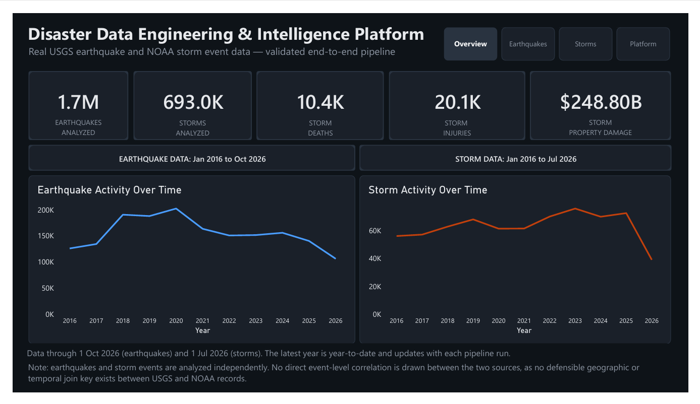
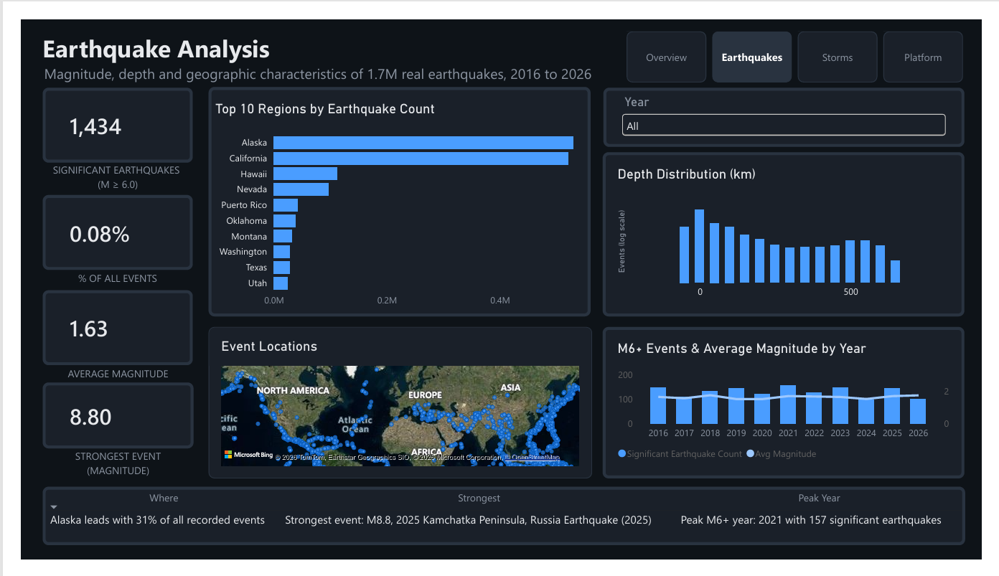
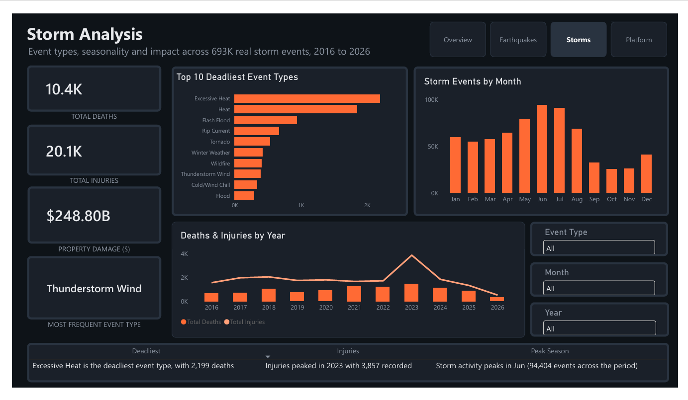
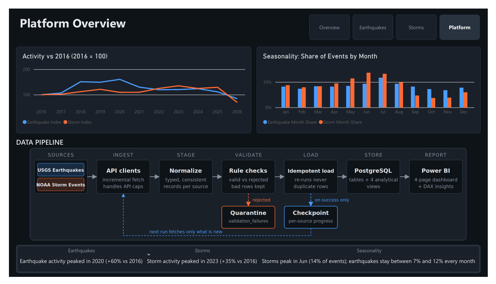

# Disaster Data Engineering & Intelligence Platform

An end-to-end data project: Python pipelines ingest public **USGS earthquake** and **NOAA storm** data into **PostgreSQL**, and a 4-page **Power BI** dashboard turns ten years of it (2016 to 2026) into insights.

- **1.7M** earthquakes (USGS) and **693K** storm events (NOAA) loaded
- Incremental, idempotent pipelines with a quarantine for bad records
- **155+ automated tests**
- A dark-theme Power BI report with dynamic, DAX-driven insights

## Dashboard

| Overview | Earthquakes |
|---|---|
|  |  |

| Storms | Platform |
|---|---|
|  |  |

### What the data showed

- **Heat, not tornadoes, is the deadliest storm type.** Excessive Heat caused 2,199 deaths in the loaded period.
- **Earthquakes have no season; storms do.** Earthquakes stay between 7% and 12% of events every month, while storms peak in June at about 14%.
- **Alaska holds about 31% of all recorded earthquakes.** The strongest event in the period was M8.8 near Kamchatka, Russia (2025).

## Architecture

```
USGS API ─┐
          ├─> Ingest ─> Stage ─> Validate ─> Load ─> PostgreSQL ─> Power BI
NOAA files┘                         │          │
                                    v          v
                               Quarantine   Checkpoint
                         (validation_failures) (advances on success only)
```

| Stage | What it does |
|---|---|
| **Ingest** | Fetches USGS events by date window and downloads NOAA yearly files |
| **Stage** | Normalizes raw records into consistent, typed structures |
| **Validate** | Applies rule checks and splits records into valid and rejected |
| **Quarantine** | Stores rejected records in `validation_failures` instead of dropping them |
| **Load** | Idempotent upserts, so re-running never duplicates rows |
| **Checkpoint** | Per-source progress, advanced only after a fully successful run |
| **Orchestrate** | `pipeline_runner.py` runs both sources in isolation, so one failure never blocks the other |

## Design decisions

- **Failure isolation.** A failing source is reported in the result, and the other source still runs.
- **Checkpoint after success only.** If any step raises, the checkpoint stays where it was, so the next run retries safely.
- **Idempotent loads.** Re-running a window updates or skips existing rows. This was verified when a backfill re-encountered already-loaded events.
- **API limits handled.** USGS caps a single request at 20,000 events, so large historical loads split date windows (the backfill scripts count events first and split dense periods).
- **Analytical views.** Four PostgreSQL views feed the dashboard.

## Project structure

```
src/
  ingestion/       USGS and NOAA clients and ingestion
  staging/         record normalization
  validation/      rule checks
  loading/         idempotent loaders
  quarantine/      rejected-record persistence
  checkpointing/   per-source checkpoints
  orchestration/   per-source pipelines and the integration runner
config/            source configuration
sql/               table and analytical view definitions
tests/             155+ automated tests
run_pipelines.py   run both pipelines incrementally
update_data.bat    double-click wrapper for Windows
backfill_*.py      one-off historical loaders
docs/              architecture notes and dashboard images
```

## Setup

Requirements: Python 3.11+, PostgreSQL.

```bash
python -m venv .venv
.venv\Scripts\activate          # Windows
pip install -r requirements.txt
```

Create the database and tables:

```bash
createdb -U postgres disaster_data
psql -U postgres -d disaster_data -f sql/create_earthquakes_table.sql
psql -U postgres -d disaster_data -f sql/create_storm_events_table.sql
psql -U postgres -d disaster_data -f sql/create_checkpoints_table.sql
psql -U postgres -d disaster_data -f sql/create_validation_failures_table.sql
psql -U postgres -d disaster_data -f sql/analytics_earthquakes.sql
psql -U postgres -d disaster_data -f sql/analytics_storm_events.sql
```

The scripts read the database password from an environment variable, so nothing secret lives in the repo:

```bash
set POSTGRES_PASSWORD=your_password      # Windows
```

## Running

```bash
python run_pipelines.py     # incremental run of both sources
pytest                      # run the test suite
```

On Windows you can also double-click `update_data.bat`, then click **Refresh** in Power BI.

The first load of a long date range should use the backfill scripts, which split windows to stay under the USGS 20,000-event request cap.

## Known limitations

- **No scheduler.** Updates are one click (`update_data.bat`) and the Power BI refresh is manual, which suits a portfolio project.
- **The two sources are analyzed independently.** There is no defensible geographic or temporal join key between USGS and NOAA records, so the dashboard compares patterns, not individual events.
- **NOAA checkpoint is source-scoped, not per year.** Multi-year backfills therefore reset the NOAA checkpoint before each year.
- **Partial latest year.** The latest year is year-to-date and grows as the pipeline runs.

## Tech stack

Python, PostgreSQL, psycopg, pytest, Power BI, DAX.

## Data sources

- USGS Earthquake Catalog (FDSN event API)
- NOAA NCEI Storm Events Database
